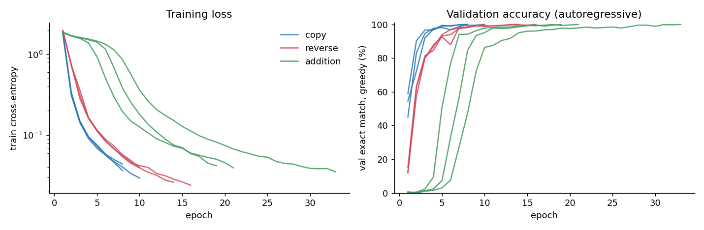
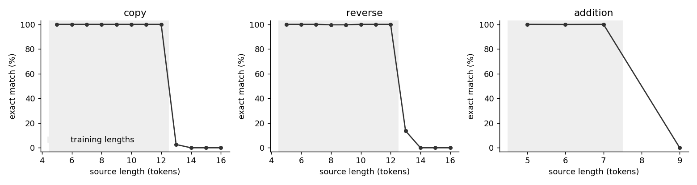
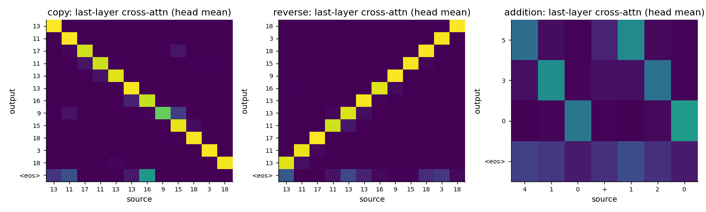
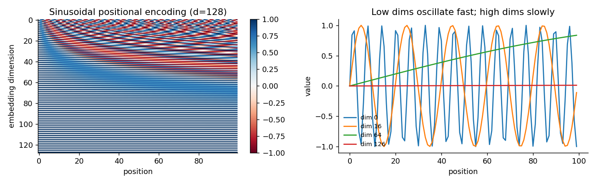
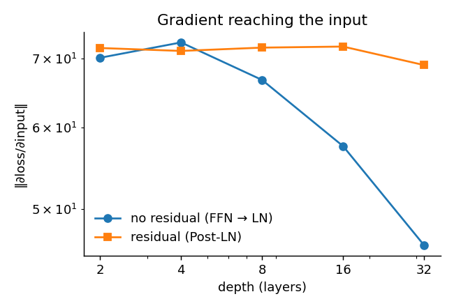

# Transformer from Scratch: Implementation, Verification and Algorithmic Probes

A PyTorch implementation of the encoder–decoder Transformer of Vaswani et al. (2017), *Attention Is All You Need*. It comes with unit tests that check the properties the architecture depends on, and a small study of how well a ~0.9M-parameter instance learns, and generalises, on three simple sequence-to-sequence tasks of increasing difficulty: **copy → reverse → multi-digit addition**.

**Author:** Khadijah Yunusa

---

## Abstract

I implemented every component of the original Transformer (sinusoidal positional encoding, scaled dot-product and multi-head attention, position-wise feed-forward layers, LayerNorm, Post-LN residual blocks, causal and padding masks, and the inverse-square-root warm-up schedule). I verified them with property tests such as decoder causality, invariance to source padding, numerical equivalence of LayerNorm to PyTorch's, and an exact closed-form parameter count. At the paper's *base* configuration with a 37k shared vocabulary and tied embeddings, the implementation has **63.1M parameters** (the paper reports 65M). For the experiments I train a scaled-down model (d_model=128, 4 heads, 2+2 layers, **~0.9M parameters**) on copy, reversal and addition. The splits are disjoint and the inputs variable-length. My primary metric is **autoregressive (greedy) exact-match accuracy on a held-out test set**, and I added an out-of-distribution test with longer inputs than any seen in training. To check that the learned attention does what it should, rather than only that it looks plausible, I measure how often cross-attention points at the source token being emitted.

## Contents

```
transformer/
  model.py      all modules + batched greedy decoding
  masks.py      boolean causal / padding masks (True = may attend)
  data.py       copy / reverse / addition tasks, disjoint splits, OOD-length sets
  train.py      training loop, Noam schedule, checkpointing + resume, evaluation
tests/          pytest suite (15 tests)
scripts/analyze.py   every figure and table below, from saved results
notebooks/
  walkthrough.ipynb      annotated step-by-step build with visualisations
  run_experiments.ipynb  one-click reproduction on a Colab T4
results/        per-run JSON (config, full history, final metrics) and figures
```

## 1. Implementation

| Component | Paper | Here |
|---|---|---|
| Attention | softmax(QKᵀ/√d_k)V (Eq. 1) | `scaled_dot_product_attention`. Masked logits are filled with the dtype's min value, so fp16 is safe. |
| Multi-head | h parallel heads, concat, W_O | `MultiHeadAttention`. Masks are boolean and broadcast to (B, h, T_q, T_k). |
| FFN | max(0, xW₁+b₁)W₂+b₂ (Eq. 2) | `FeedForward` |
| Positional encoding | fixed sinusoids (§3.5) | `PositionalEncoding`, registered as a buffer (not learned) |
| Embedding scale | × √d_model (§3.4) | `TokenEmbedding` |
| Residual + norm | LayerNorm(x + Sublayer(x)) | `ResidualConnection`: **Post-LN**, hand-written `LayerNorm` |
| Weight tying | shared src/tgt embedding + pre-softmax (§3.4) | `tie_embeddings=True` (tested; off in the experiments) |
| LR schedule | d^-0.5 · min(s^-0.5, s·w^-1.5) (Eq. 3) | `NoamScheduler`, with Adam(β=(0.9, 0.98), ε=1e-9) |
| Decoding | beam search | batched **greedy** decoding (`Transformer.greedy_decode`) |

**Configurations**

| | Paper base | This implementation at base size | Experiments |
|---|---|---|---|
| d_model / heads / d_ff | 512 / 8 / 2048 | 512 / 8 / 2048 | 128 / 4 / 512 |
| layers (enc + dec) | 6 + 6 | 6 + 6 | 2 + 2 |
| vocabulary | 37k shared BPE | 37k, tied | 14–20 task tokens |
| parameters | 65M | **63.1M** (tied) | **~0.9M** |

The 63.1M figure is checked against a closed-form count in `tests/test_model.py`. The same formula gives 59.5M for an untied model with a 10k vocabulary. I have not identified the source of the ~2M gap to the paper's figure; it is most likely a vocabulary-size or bias difference that the paper doesn't specify.

## 2. Verification

`pytest -q` runs these checks:

- **Causality:** perturbing target tokens at positions ≥ t leaves decoder outputs at positions < t unchanged.
- **Padding invariance:** appending PAD tokens to the source leaves the output unchanged. My first draft fails this test (see §6).
- **Attention:** rows sum to 1, and masked entries are exactly 0.
- **LayerNorm:** the hand-written version matches `torch.nn.LayerNorm` to 1e-5.
- **Positional encoding:** the rate of change decreases monotonically with dimension index.
- **Parameter count:** matches the closed form, for both tied and untied variants.
- **Data:** train, validation, test and OOD splits are disjoint, and addition targets are arithmetically correct.
- **Schedule:** the learning rate peaks exactly at `warmup_steps`, at d^-0.5·w^-0.5.

## 3. Experimental setup

| Task | Input → output | Vocabulary | Training lengths | OOD lengths |
|---|---|---|---|---|
| copy | x₁…xₙ → x₁…xₙ | 17 symbols | n ∈ [5, 12] | n ∈ [13, 16] |
| reverse | x₁…xₙ → xₙ…x₁ | 17 symbols | n ∈ [5, 12] | n ∈ [13, 16] |
| addition | `a+b` (characters) → digits of a+b | 0–9, `+` | 1–3-digit operands | 4-digit operands |

- **Data.** For each seed I draw one pool of *unique* examples and split it into train, validation and test, so no test input appears in training. Sizes are 20k / 1k / 2k, with 50k training examples for addition and a 1k OOD set. Sequences have variable length, so padding masks are exercised.
- **Training.** Adam with the Noam schedule (warm-up 400 steps), batch size 128, dropout 0.1, gradient clipping at 1.0, and no label smoothing.
- **Model selection.** I keep the checkpoint with the best *greedy* exact match on the validation set, and stop early after `patience` epochs without improvement or as soon as validation exact match reaches 100%.
- **Metrics.** The primary metric is **greedy exact match**: the whole output sequence is generated autoregressively with no access to the target, and it must equal the target exactly. I also report teacher-forced token accuracy, which is easier and is shown for contrast. Final numbers come from the **test** and **OOD** sets, which play no part in any training decision.
- **Seeds.** Each task is run with 3 seeds (0, 1, 2). The seed controls data generation, initialisation and shuffling.
- **Checkpointing.** `checkpoints/<task>_s<seed>/last.pt` stores the model, optimiser, scheduler, RNG states and history, so a run can be resumed exactly with `--resume`. `best.pt` holds the selected model.

## 4. Results

<!-- RESULTS:START -->
| Task | Params | Seeds | Epochs | Test token acc, teacher-forced (%) | **Test exact match, greedy (%)** | OOD-length exact match, greedy (%) |
|---|---:|---:|---|---:|---:|---:|
| copy | 933,396 | 3 | 10, 8, 8 | 100.0 ± 0.0 | **99.8 ± 0.2** | 2.2 ± 2.6 |
| reverse | 933,396 | 3 | 14, 16, 10 | 100.0 ± 0.0 | **99.8 ± 0.1** | 1.2 ± 1.7 |
| addition | 931,086 | 3 | 19, 21, 33 | 100.0 ± 0.0 | **99.9 ± 0.1** | 0.0 ± 0.0 |

Mean ± std over seeds. Per-seed test exact match: copy [100.0, 99.6, 99.75]; reverse [99.9, 99.9, 99.6]; addition [99.95, 99.95, 99.8].

**Attention alignment** (seed 0, 500 test examples): fraction of output steps whose head-averaged last-layer cross-attention argmax lands on the source token being emitted: copy **100.0%**, reverse **100.0%**.

**Exact match by source length** (seed 0):

- copy: len 5: 100%, len 6: 100%, len 7: 100%, len 8: 100%, len 9: 100%, len 10: 100%, len 11: 100%, len 12: 100%, len 13: 3%, len 14: 0%, len 15: 0%, len 16: 0%
- reverse: len 5: 100%, len 6: 100%, len 7: 100%, len 8: 100%, len 9: 100%, len 10: 100%, len 11: 100%, len 12: 100%, len 13: 14%, len 14: 0%, len 15: 0%, len 16: 0%
- addition: len 5: 100%, len 6: 100%, len 7: 100%, len 9: 0%
<!-- RESULTS:END -->



*Figure 1. Training loss (log scale) and validation greedy exact match, all seeds.*



*Figure 2. Test exact match by source length. The shaded region marks lengths seen in training; points to its right are the OOD set.*



*Figure 3. Last-layer decoder cross-attention (averaged over heads) for one test example per task, from the trained models.*

### Findings

**In-distribution, all three tasks are solved.** Greedy exact match on held-out test sets is 99.8 ± 0.2% (copy), 99.8 ± 0.1% (reverse) and 99.9 ± 0.1% (addition) over 3 seeds. Teacher-forced token accuracy rounds to 100.0% throughout, so the cost of decoding without access to the target is small (≤0.2 points). Difficulty shows up in training cost rather than final accuracy: copy converged in 8–10 epochs (~1.3–1.6k steps), reverse in 10–16 (~1.6–2.5k), and addition in 19–33 epochs on 2.5× more data (~7.4–12.9k steps).

**Attention implements the algorithm.** For copy and reverse, the head-averaged last-layer cross-attention argmax lands on the exact source token being emitted at 100% of output steps (seed 0, 500 test examples). The learned alignment is the diagonal for copy and the anti-diagonal for reverse (Fig. 3).

**There is no length generalisation.** Accuracy drops sharply at the boundary of the training lengths: from 100% at length 12 to 3% (copy) and 14% (reverse) at length 13, and to 0% from length 14 onwards. Addition with 4-digit operands, which never appear in training, scores 0% (seed 0). Sinusoidal encodings are defined for any position, but the model does not use them to extrapolate, consistent with Press et al. (2022). I haven't yet tested *how* these failures happen, for example whether the model emits EOS too early or produces wrong tokens. That, and comparing relative position schemes (ALiBi, RoPE) against sinusoidal encoding, is the natural next experiment.

### Component analyses



*Figure 4. Sinusoidal positional encoding. Low dimension indices oscillate fastest (wavelength 2π at dimension 0) and high indices slowest (up to 10000·2π).*



*Figure 5. Norm of the gradient reaching the input of a stack of FFN+LayerNorm layers, with and without skip connections, as depth grows. The loss is a projection onto a fixed random direction (see §6 for why `output.sum()` is not a valid probe).*

## 5. Deviations from the paper

- **Decoding:** greedy rather than beam search (beam size 4, length penalty 0.6 in the paper).
- **Label smoothing:** off (the paper uses ε_ls = 0.1). With smoothing on, the loss can't approach 0, which makes the curves harder to read on deterministic tasks.
- **No weight tying in the experiments:** the option is implemented and its parameter count is tested, but I did not use it in the experiments.
- **Scale:** the experiments use ~0.9M parameters on synthetic tasks, not 65M on WMT. The base configuration is instantiated and tested but not trained.
- **Gradient clipping** at norm 1.0, which the paper does not mention.

## 6. Errata: bugs found in my first draft

I first built this as a single notebook. Rewriting it with tests exposed these problems, all fixed here:

| Bug | Symptom | Fix |
|---|---|---|
| `MultiHeadAttention` unsqueezed masks a second time | A (B,1,1,S) padding mask became 5-D. This went unnoticed only because no padding mask was ever used. | Masks are built 4-D once, in `masks.py`; the padding-invariance test covers this. |
| Look-ahead mask was a float tensor | `look_ahead & padding` raised `bitwise_and not implemented for Float` | Boolean masks throughout |
| LayerNorm divided by `std + eps`, using the unbiased std | Didn't match the standard LayerNorm formula | Biased variance with eps inside the √; checked against `nn.LayerNorm` |
| Residual-gradient demo used `loss = output.sum()` | Reported a gradient of exactly 0 "with residuals": LayerNorm rows sum to 0, so that loss is constant | Probe with a fixed random projection (Fig. 5) |
| Extra final LayerNorm after Post-LN stacks | Two consecutive norms; a Pre-LN convention mixed into a Post-LN model | Removed |
| Positional-encoding description | Said low dimensions vary slowly, which is the reverse of the truth | Corrected, with a test |
| "99%" accuracy was teacher-forced, on the early-stopping set | Overstated what the model could do at inference time | Greedy exact match on a held-out test set |
| Attention "patterns" plotted from untrained modules on random input | These showed initialisation noise, not learned behaviour | Attention from trained models, plus a quantitative alignment score |

## 7. Limitations

These are small algorithmic tasks. Success here shows the implementation is correct and trainable, it says little about natural-language performance. Three seeds give only a rough estimate of variance. I didn't tune hyperparameters beyond reasonable defaults, so the addition results especially are not the best this architecture can do.

## Reproduce

```bash
pip install -r requirements.txt
pytest -q
python -m transformer.train --task reverse --seed 0          # any of copy | reverse | addition
python -m transformer.train --task addition --seed 0 --n_train 50000 --epochs 80 --patience 10
python scripts/analyze.py --tasks copy reverse addition --seeds 0 1 2
```

Or open `notebooks/run_experiments.ipynb` in Colab (T4) and choose Run all.

## References

- A. Vaswani et al. *Attention Is All You Need.* NeurIPS 2017.
- J. L. Ba, J. R. Kiros, G. E. Hinton. *Layer Normalization.* 2016.
- A. Rush. *The Annotated Transformer.* 2018.
- R. Xiong et al. *On Layer Normalization in the Transformer Architecture.* ICML 2020 (Pre-LN vs Post-LN).
- O. Press, N. Smith, M. Lewis. *Train Short, Test Long: Attention with Linear Biases Enables Input Length Extrapolation.* ICLR 2022.
